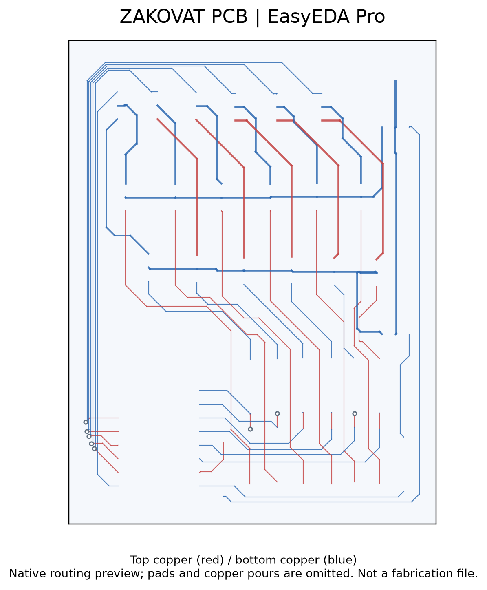
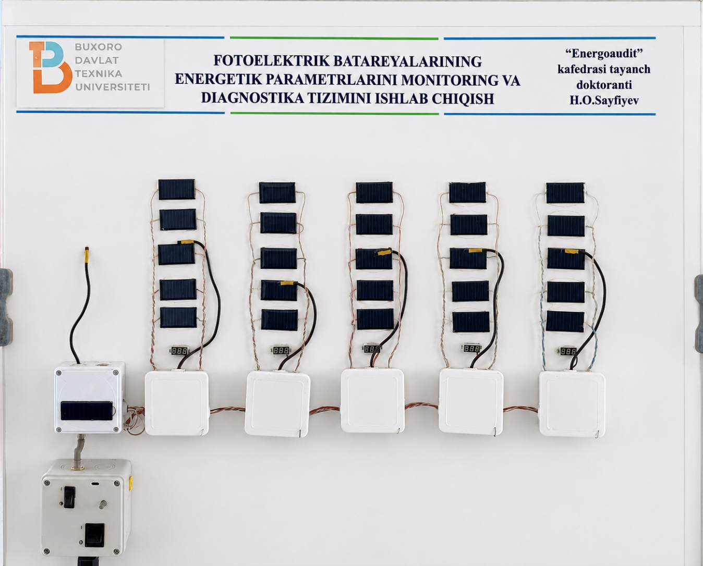
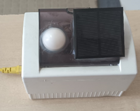
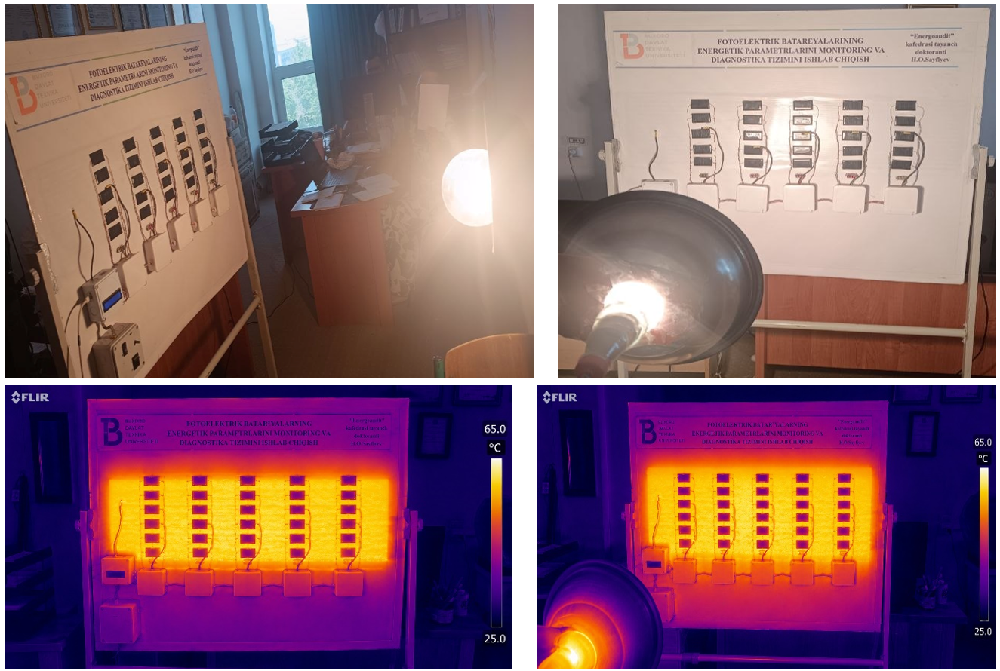
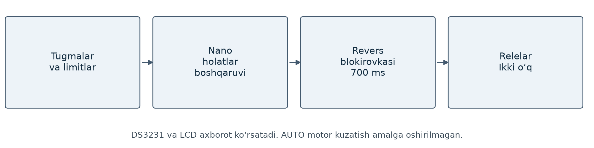
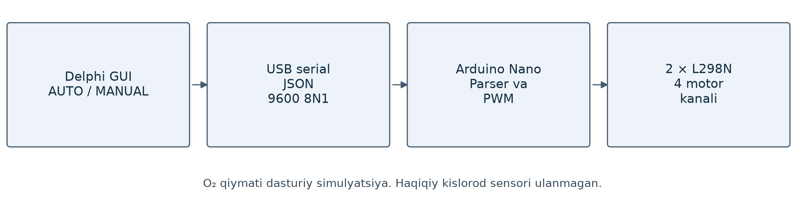

# PCB va elektron qurilmalar

EasyEDA Pro muhitida elektron sxema, komponent joylashuvi va PCB yo‘llarini loyihalayman. Buyurtma asosida ikki va undan ortiq qatlamli platalar tayyorlaganman. Bir qatlamli PCB tayyorlashda 3D printerdan foydalanganman.

## PCB ishlari

| Loyiha | Asosiy komponentlar yoki vazifa |
|---|---|
| LM358 moduli | Analog signalni kuchaytirish va moslashtirish |
| Markaziy boshqarish bloki | Mikrokontroller va boshqaruv interfeyslari |
| Sensorli kontroller | Arduino Nano, DS18B20, ACS712 va RTC |
| Zakovat | Arduino Nano, PC817 va IRFZ44N kalitlari |
| Kuchlanish bo‘lgichi | O‘lchash kirishi uchun kuchlanishni moslashtirish |

Zakovat loyihasining top va bottom mis yo‘llari. Tasvirda padlar va mis to‘ldirishlar ko‘rsatilmagan; ishlab chiqarish fayllari alohida saqlanadi.

## PV o‘lchash va monitoring qurilmalari

Modul darajasidagi o‘lchash, string bo‘yicha yig‘ish va markaziy monitoring bloklari.

Yoritilish va tashqi muhit monitoringi bilan bog‘liq tajriba qurilmasi.

Fotoelektrik modullar va ularning harorat holatini laboratoriya sharoitida kuzatish.

## Arduino boshqaruv arxitekturalari

[Barcha loyihalar](README.md) · [PV tadqiqoti](RESEARCH.md)
