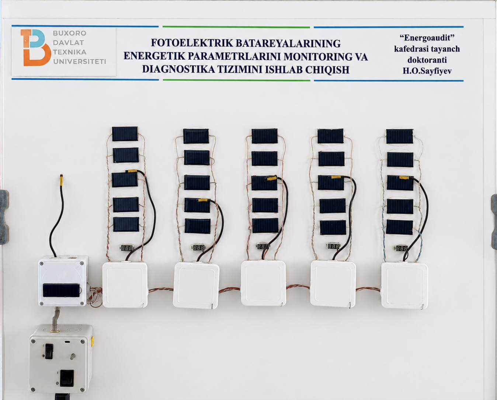

# Hasan Sayfiyevning muhandislik va ilmiy ishlari

Men — Sayfiyev Hasan Olim o‘g‘li, Buxoro davlat texnika universiteti assistenti va doktorant tadqiqotchiman. Elektronika, PCB, mikrokontrollerlar, fotoelektrik tizimlar monitoringi va dasturiy mahsulotlar bilan shug‘ullanaman.

[Men haqimda](ABOUT.md) · [Ilmiy tadqiqot](RESEARCH.md) · [Nashrlar](PUBLICATIONS.md) · [PCB va qurilmalar](HARDWARE.md) · [Ta’lim va ish faoliyati](EDUCATION_AND_WORK.md) · [Wikipedia](https://uz.wikipedia.org/wiki/Foydalanuvchi:Sayfiyev_Hasan)

## Loyihalar

| Loyiha | Asosiy texnologiyalar | Tarkib |
|---|---|---|
| [Fotoelektrik monitoring va diagnostika](projects/pv-monitoring/README.md) | Arduino Mega, ATtiny85, sensorlar, RS-485, Delphi | Arxitektura, tadqiqot qurilmasi fotosurati, nashrlar |
| [PCB loyihalash](projects/pcb-design/README.md) | EasyEDA Pro | Sxema va plata loyihalash tajribasi, routing ko‘rinishi |
| [Zakovat elektron qurilmasi](projects/zakovat/README.md) | Arduino Nano, PC817, IRFZ44N | PCB tarkibi va ko‘rinishi |
| [Ochiq kanalda suv monitoringi](projects/water-flow/README.md) | Arduino, I²C, SLS720P, DYP, SR04M-2 | Master/slave arxitekturasi |
| [Quyosh trekeri](projects/solar-tracker/README.md) | Nano, DS3231, LCD, relelar | MANUAL V7 kodi, algoritm va pin xaritasi |
| [Aeratsiya demonstratori](projects/aeration-demo/README.md) | Delphi, Nano, L298N, serial JSON | Arduino va Delphi manbalari, ulanish va ishga tushirish |
| [Office Imlo](https://github.com/usta-hasan/Office-Imlo) | C#, VBA, COM | Foydalanuvchi qo‘llanmasi va o‘rnatuvchi |
| [Elektron o‘lchash](projects/measurement-networks/README.md) | DS18B20, BH1750, ACS712, LM358 | Sensor integratsiyasi va o‘lchash bloklari |
| [PV modellashtirish](projects/matlab-models/README.md) | MATLAB/Simulink | Volt-amper xarakteristikasi va tashqi omillar tadqiqoti |

## Fotoelektrik monitoring stendi

Tizim fotoelektrik modullarning tok, kuchlanish, harorat va yoritilish parametrlarini yig‘ish hamda kuzatish uchun ishlab chiqilgan. Tadqiqot 05.05.06 ixtisosligi bilan bog‘liq.

## Dastur kodlari

- [Quyosh trekeri firmware’i](projects/solar-tracker/source/Solar_tracker) — ikki o‘qli qo‘lda boshqaruv.
- [Arduino aeratsiya kodi](projects/aeration-demo/source/Akvarium/Akvarium.ino) — to‘rtta motor uchun JSON buyruqlarini qabul qilish.
- [Delphi dasturi](projects/aeration-demo/source/Delphi) — boshqaruv interfeysi va serial aloqa.

Kutubxonalar, ulanishlar va joriy funksiyalar tegishli loyiha yo‘riqnomasida ko‘rsatilgan. Foydalanish shartlari: [RIGHTS.md](RIGHTS.md).

## Aloqa

[GitHub profil](https://github.com/usta-hasan) · [Telegram](https://t.me/usra_hasan) · [Email](mailto:hasansoftware6451122@gmail.com)
