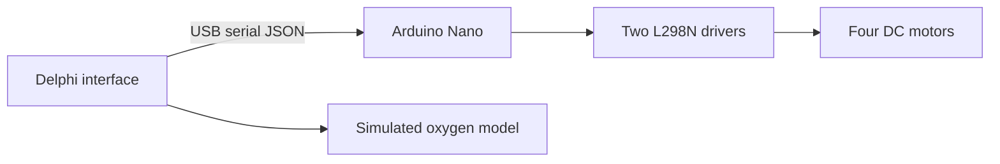

# Arduino and Delphi aeration demonstrator

A Windows Delphi application controls four DC motor channels through an Arduino Nano and two L298N drivers. Serial packets use JSON over 9600 8N1. The oxygen value is simulated: no real dissolved-oxygen sensor is integrated. Existing project records report a Delphi Win32 build, 26 regression checks and an AVR compile. Selected application and firmware sources are included; no hardware test or firmware upload is claimed.

## O‘zbekcha tavsif

To‘rtta motor tezligini Windows dasturidan boshqarish va avtomatik/manual rejimni namoyish qilish.

Delphi VCL interfeysi USB serial orqali Nano ga qat’iy JSON paketlarini yuboradi. Nano ikkita L298N orqali to‘rtta DC motor kanalini boshqaradi.

**Texnologiyalar:** Delphi/Object Pascal, Windows serial API, Arduino C++, Nano, 2×L298N, JSON, 9600 8N1.

**Algoritm:** MANUAL qiymat yoki AUTO hisob → 0–100% qiymatlar → JSON → parser tekshiruvi → PWM → tasdiq paketi. O₂ ko‘rsatkichi dasturiy modeldan olinadi.

**Shaxsiy hissa:** Arduino–Delphi integratsiyasi, serial protokol, GUI va boshqaruv mantiqi; AI yordamidagi takomillashtirish va sinov qaydlari mavjud.

**Natija va holat:** Mavjud qaydlarda Delphi Win32 build, 26 regressiya tekshiruvi va Nano kompilyatsiyasi muvaffaqiyatli. Arduino: 3548 bayt flash, 349 bayt RAM. Real O₂ sensori ulanmagan; firmware upload qilinmagan. Namoyish tizimi. O₂ qiymati simulyatsiya, o‘lchangan biologik ko‘rsatkich emas.

## Architecture

[Setup and pin map](SETUP.md)
