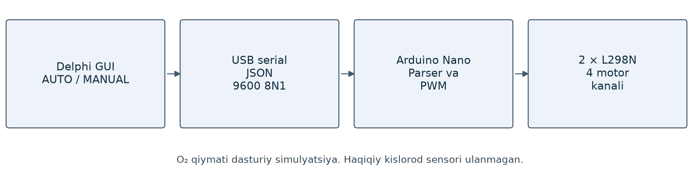

# Arduino va Delphi asosidagi aeratsiya demonstratori

Delphi VCL dasturidan Arduino Nano ga USB serial orqali buyruq yuborib, to‘rtta motor kanalini boshqarish. L298N drayverlari va JSON paketlari ishlatilgan.

## Ishlashi

MANUAL rejimida motor qiymatlari qo‘lda kiritiladi. AUTO rejimida dastur model bo‘yicha qiymatlarni hisoblaydi. Nano paketni tekshiradi va 0–100% buyruqni PWM chiqishlariga o‘tkazadi. O₂ ko‘rsatkichi demonstratorda simulyatsiya qilinadi.

## Texnik tarkib

- Delphi/Object Pascal, Windows serial API.
- Arduino Nano, ikkita L298N va to‘rtta DC motor kanali.
- 9600 baud, 8N1, JSON va tasdiq paketi.
- Arduino tomonida qat’iy parser va bufer nazorati.

## Kod va ulanish

- [Arduino kodi](source/Akvarium/Akvarium.ino)
- [Delphi manbalari](source/Delphi)
- [Ulanish va muhit talablari](SETUP.md)

Loyiha qaydida Delphi Win32 build, 26 regressiya tekshiruvi va AVR kompilyatsiyasi mavjud.
