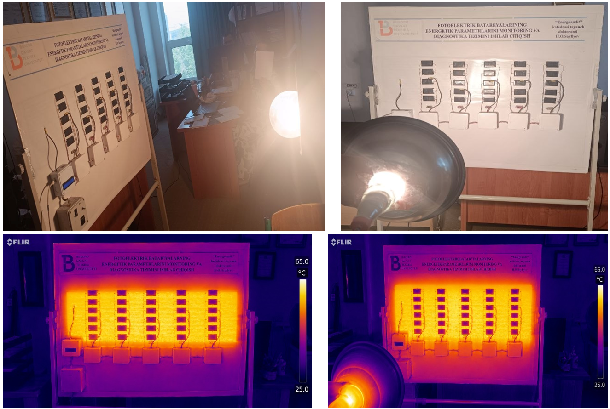

# Photovoltaic modelling in MATLAB and Simulink

Research documents describe photovoltaic I–V modelling with irradiance, temperature and external influences. The dissertation and the 2025 Urgench conference contribution support this activity. The original photovoltaic .slx file has not been recovered, so this repository does not claim to provide a reproducible simulation package.

## O‘zbekcha tavsif

Fotoelektrik modulning volt-amper xarakteristikasi va tashqi omillar ta’sirini tahlil qilish.

Dissertatsiya va maqolalarda yoritilish, harorat, issiqlik balansi va changlanganlik ta’sirini hisoblash hamda MATLAB/Simulink model tasvirlari.

**Texnologiyalar:** MATLAB, Simulink, fotoelektrik model, tajriba natijalarini tahlil qilish.

**Algoritm:** Boshlang‘ich parametrlar → PV model → yoritilish/harorat ssenariylari → I–V xarakteristika va taqqoslash.

**Shaxsiy hissa:** PV parametrlarini hisoblash va tadqiqot natijalarini tahlil qilish; natijalarni maqola va dissertatsiyada yoritish.

**Natija va holat:** Model ishlatilishi dissertatsiya va P12 bilan tasdiqlanadi. Asl PV .slx fayli topilmadi; Dars_1.slx o‘quv fayli alohida bo‘lib, ilmiy model o‘rniga taqdim etilmadi. Hujjatlarda tasdiqlangan tadqiqot; qayta ishga tushiriladigan PV model paketi mavjud emas.

Selected project image from the author’s dissertation.

Related publications: [catalogue](../../PUBLICATIONS.md). Full research source is not included in this release.
