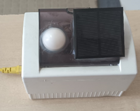

# Electronic measurement and sensor integration

Practical measurement work across photovoltaic and embedded projects: sensor acquisition, analogue signal conditioning and data transport. Technologies include Arduino Mega/Nano, ATtiny85, DS18B20, BH1750, ACS712, LM358, I²C, UART and RS-485. Modbus RTU experience is author-reported. This page groups related competencies and does not add a separate product to the project count.

## O‘zbekcha tavsif

Energetika va avtomatlashtirish tajribalarida tok, kuchlanish, harorat va yoritilish ma’lumotlarini yig‘ish.

Mikrokontroller, analog signalni moslashtirish, sensor interfeysi va markaziy qayd etish dasturini bir tizimga birlashtirish.

**Texnologiyalar:** Arduino Mega/Nano, ATtiny85; DS18B20, BH1750, ACS712, LM358; I²C, UART, RS-485. Modbus RTU tajribasi foydalanuvchi bayonoti bilan qayd etilgan.

**Algoritm:** O‘lchash → signalni moslashtirish → raqamlashtirish → uzatish → qayd etish va tahlil.

**Shaxsiy hissa:** Elektron bloklarni yig‘ish, mikrokontroller dasturlash, sensorlarni ulash va nosozliklarni tekshirish.

**Natija va holat:** PV dissertatsiya qurilmalari va EasyEDA sxemalari bilan amaliy ish tasdiqlangan. Har bir sensor uchun kalibrlash/noaniqlik hisobotlari to‘liq topilmadi. Bir nechta loyihani birlashtiruvchi kompetensiya; alohida mustaqil mahsulot deb hisoblanmaydi.

Selected project image from the author’s dissertation.

Related publications: [catalogue](../../PUBLICATIONS.md). Full research source is not included in this release.
