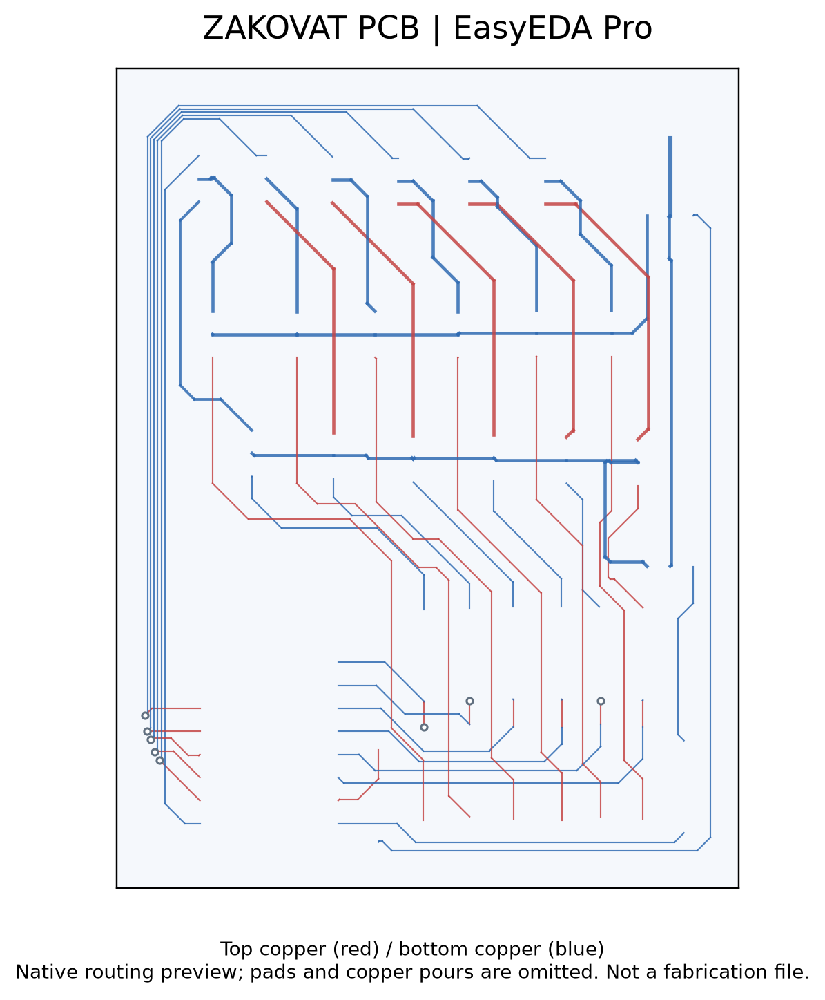

# PCB design in EasyEDA Pro

Commissioned PCB design in EasyEDA Pro, including schematic capture, placement and routing. Native files demonstrate top and bottom copper routing in several boards. The author also reports work on boards with more than two layers and single-layer fabrication assisted by a 3D printer. Those fabrication details have not been independently checked. The routing illustration is generated from the Zakovat native design; pads and copper pours are omitted, so it is not a manufacturing file.

## O‘zbekcha tavsif

Buyurtma va tajriba qurilmalari uchun elektron sxema hamda bosma platalar tayyorlash.

EasyEDA Pro muhitida sxema, komponent joylashuvi va yo‘llarni loyihalash. LM358 moduli, markaziy boshqarish bloki va Zakovat platalarida top/bottom mis yo‘llari mavjud.

**Texnologiyalar:** EasyEDA Pro; Arduino Nano, LM358, PC817, IRFZ44N, DS18B20, ACS712 va boshqa loyiha komponentlari.

**Algoritm:** Talabni aniqlash → sxema → komponentlar → PCB joylashuvi → yo‘llar → tekshirish → tayyorlash va yig‘ish.

**Shaxsiy hissa:** Buyurtma asosida PCB sxemasi va platasini loyihalash, tayyorlash jarayoni va elektron yig‘ish.

**Natija va holat:** 12 ta .eprj loyiha fayli topildi. To‘rtta tanlangan platada ikki tomonlama yo‘llar tasdiqlandi. Foydalanuvchi ikki va undan ortiq qatlamli buyurtma platalarini hamda 3D printer yordamida bir qatlamli PCB tayyorlaganini bildirgan; 2 qatlamdan ortiq stackup va 3D jarayoni alohida tasdiq talab qiladi. Ikki qatlamli routing asl CAD bilan tasdiqlangan; ko‘p qatlamli tajriba foydalanuvchi bayonoti.

Native routing preview, not a fabrication output.

Customer CAD sources and manufacturing outputs are not included. The preview cannot be used to manufacture a board.
