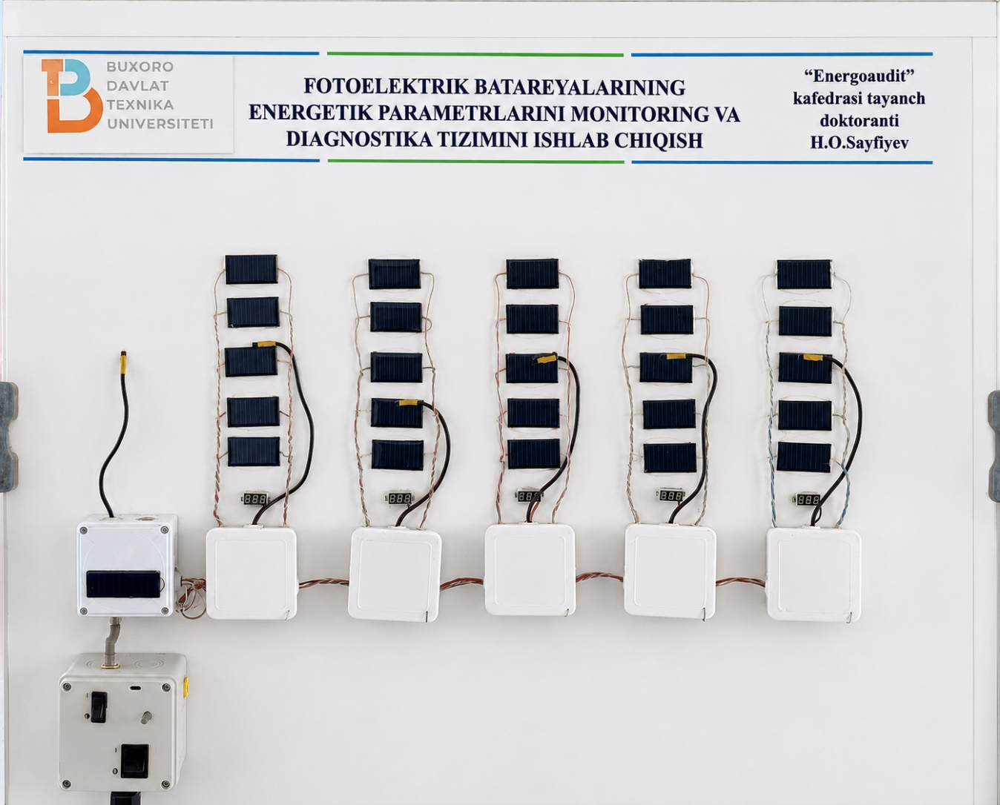

# Fotoelektrik monitoring va diagnostika

Fotoelektrik modullarning energetik parametrlarini o‘lchash va kuzatish uchun tizim.

## Ishlar

Modul o‘lchash bloki → string kontrolleri → markaziy kontroller → kompyuter monitoring dasturi.

## Texnologiyalar

Arduino Mega 2560, ATtiny85, DS18B20, BH1750, LM358, I²C, RS-485, Delphi.

[Ilmiy tadqiqot](../../RESEARCH.md) · [Nashrlar](../../PUBLICATIONS.md)
