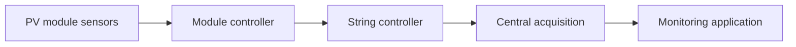

# Photovoltaic monitoring and diagnostics

A modular measurement and data-acquisition system for photovoltaic installations. Module and string measurements feed a central monitoring application. Research covers voltage, current, temperature, irradiance and environmental effects. Implementation is documented at two sites; projected efficiency gains are not presented as measured results. Selected publications are linked in the bibliography. Unpublished patent material and full implementation source are not part of this release.

## O‘zbekcha tavsif

Fotoelektrik batareyalar ishchi parametrlarini kuzatish, tashqi omillar ta’sirini baholash va nosozliklarni aniqlash.

Modul darajasidagi o‘lchash bloklari, string kontrolleri va markaziy ma’lumot yig‘ish dasturi. Kuchlanish, tok, harorat va yoritilish ma’lumotlari birgalikda tahlil qilinadi.

**Texnologiyalar:** Arduino Mega 2560, ATtiny85, DS18B20, LM358 va shunt, BH1750, I²C, RS-485, Delphi, MATLAB/Simulink.

**Algoritm:** Sensorlardan olish → masshtablash va saralash → kontrollerga uzatish → saqlash → parametrlar o‘zgarishini kuzatish va diagnostika.

**Shaxsiy hissa:** O‘lchash qurilmalari, monitoring algoritmi, elektron bloklar va kompyuter dasturi bo‘yicha tadqiqot hamda amaliy ishlab chiqish; ilmiy rahbar va hammualliflar bilan hamkorlik.

**Natija va holat:** Ikki maydonda joriy etish dalolatnomasi: 20.10.2025. Energetika vazirligi xati: 26.06.2026. Dalolatnomalarda iqtisodiy samara qayd etilgan; 22% va 26% esa kutilayotgan natijalar sifatida yozilgan. Tadqiqot va hujjat bilan tasdiqlangan joriy etish. PhD darajasi berilgani tasdiqlanmagan.

Selected project image from the author’s dissertation.

Related publications: [catalogue](../../PUBLICATIONS.md). Full research source is not included in this release.

## Architecture

