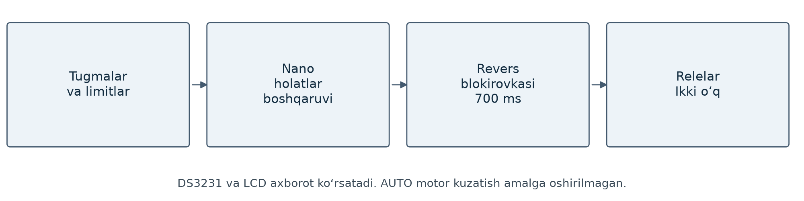

# Quyosh trekerining ikki o‘qli qo‘lda boshqaruvi

Arduino Nano asosidagi MANUAL V7 boshqaruvi. Tugmalar yordamida ikki o‘qdagi motorlar rele orqali boshqariladi; limitlar va revers blokirovkasi ishlatiladi.

## Funksiyalar

- Tugmani ushlab turib harakatlantirish va qo‘yib yuborilganda to‘xtatish.
- Double-click orqali yo‘nalishni ushlab turish.
- Reversdan oldin 700 ms kutish; 60 s uzluksiz yurish cheklovi.
- Limit va qarama-qarshi buyruqlarni nazorat qilish.
- MID tugmasi orqali STOP va LCD sahifalarini almashtirish.
- DS3231 va LCD orqali vaqt va hisobiy ma’lumotlarni ko‘rsatish.

Joriy versiya qo‘lda boshqaruv uchun. Avtomatik quyosh kuzatish rejimi qo‘shilmagan.

## Manbalar

- [Firmware](source/Solar_tracker)
- [Ulanish va ishga tushirish](SETUP.md)

Loyiha test qaydida 51/51 host testi, 36 581 displey tekshiruvi va AVR kompilyatsiyasi bor. Jismoniy rele/motor sinovlari alohida bajariladi.
