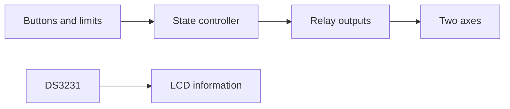

# Two-axis solar tracker manual controller

Arduino Nano firmware for manual two-axis relay control, with a 700 ms reversal interlock, limit handling and a 60 s run timeout. RTC calculations are displayed for information; automatic solar tracking is not implemented. Existing project records report 51/51 host tests and 36,581 display assertions. Hardware validation remains outstanding. Selected source files are included under source/Solar_tracker; external libraries are not bundled.

## O‘zbekcha tavsif

Ikki o‘qli mexanizmni tugmalar, limitlar va revers blokirovkasi orqali boshqarish.

Har o‘q uchun boshqaruv holatlari; 700 ms revers kutish, 60 s uzluksiz yurish cheklovi, limit nazorati va MID STOP. RTC/LCD hisoblari axborot uchun.

**Texnologiyalar:** Arduino Nano ATmega328P, C++, OneButton 2.6.2, DS3231, LCD 1602 I²C, to‘rtta rele.

**Algoritm:** Tugma va limitlar → debounce → boshqaruv holati → yo‘nalish blokirovkasi → rele chiqishlari; LCD/RTC ma’lumoti alohida yangilanadi.

**Shaxsiy hissa:** Boshqaruv firmware’i, pin xaritasi, ish algoritmi va loyiha hujjatlari; saqlangan ishlab chiqish tarixida AI yordamidagi kod tekshiruvi ham mavjud.

**Natija va holat:** Mavjud test qaydida 51/51 host sinovi, 36 581 displey tekshiruvi va ikki Nano bootloader konfiguratsiyasi uchun kompilyatsiya qayd etilgan. Ushbu portfolio seansida bu testlar qayta bajarilmadi; apparat sinovi va upload qayd etilmagan. MANUAL firmware. Avtomatik quyosh kuzatish hali amalga oshirilmagan.

## Architecture

[Setup and pin map](SETUP.md)
