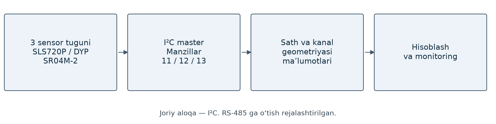

# Ochiq kanal suv monitoringi

Suv sathi va sensor ko‘rsatkichlarini master orqali yig‘ish tizimi. Bitta masterga uchta sensor tuguni ulangan.

| Tugun | Sensor | I²C manzili |
|---|---|---|
| 1 | SLS720P | 11 |
| 2 | DYP | 12 |
| 3 | SR04M-2 | 13 |

Slave tugunlar sensorni o‘qiydi; master so‘rov berib ma’lumotlarni yig‘adi. Keyingi hisoblar sath va kanal geometriyasi ma’lumotlariga bog‘liq. Uzoq kabeldagi aloqa uchun RS-485 ga o‘tish rejalashtirilgan. Joriy loyiha I²C asosida.
