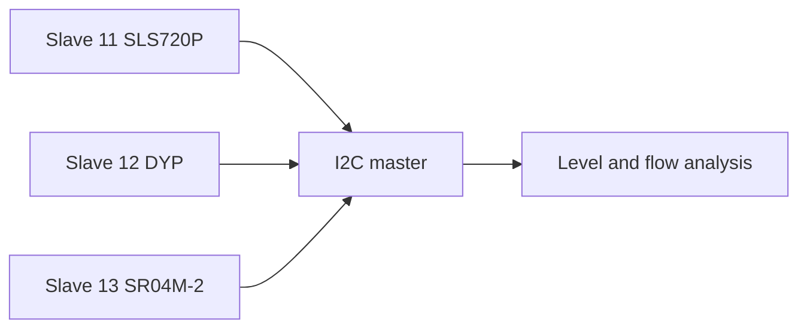

# Open-channel water-flow monitoring

A master with three sensor nodes, using SLS720P, DYP and SR04M-2 sensors on I²C addresses 11, 12 and 13. Long cable and noise issues motivated a planned RS-485 migration. This page documents the architecture; it does not claim a completed RS-485 implementation or calibrated discharge accuracy. Legacy sketches containing third-party authorship notices are not republished.

## O‘zbekcha tavsif

Ochiq kanal suv sathi va sensor ma’lumotlarini yig‘ish asosida suv sarfini kuzatish.

Bitta master va uchta sensor slave bloki. I²C manzillari 11, 12, 13; uzoq sim va shovqin muammolari sabab RS-485 ga o‘tish rejalashtirilgan.

**Texnologiyalar:** Arduino, I²C, SLS720P, DYP, SR04M-2 ultratovush sensorlari; rejalashtirilgan RS-485.

**Algoritm:** Slave sensorni o‘qiydi → master so‘rov beradi → natijalar yig‘iladi → sath/geometriya ma’lumotlari asosida hisoblash.

**Shaxsiy hissa:** Sensor bloklari integratsiyasi, master/slave tizimi va aloqa muammolarini tekshirish.

**Natija va holat:** Taqsimlangan sensor arxitekturasi va ishchi loyiha hujjatlari mavjud. Yakuniy gidravlik kalibrlash va RS-485 migratsiyasi yakunlangani tasdiqlanmagan. Ishlab chiqish bosqichi. RS-485 shu loyiha uchun reja.

## Architecture

