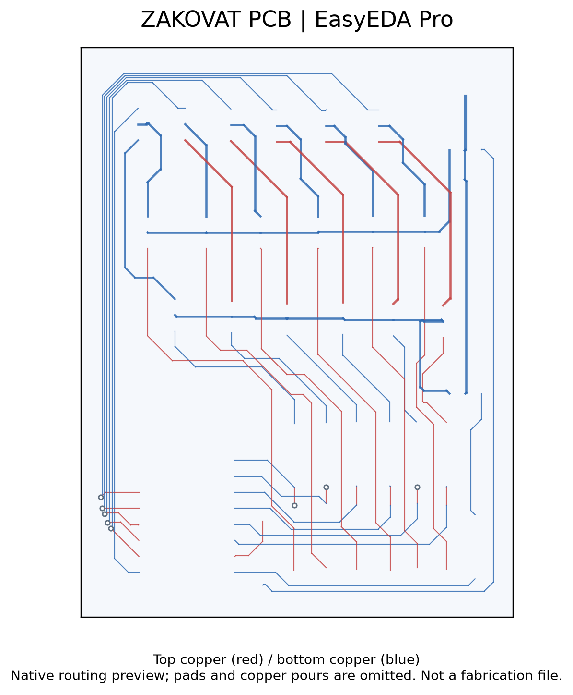

# Zakovat game electronics

A custom Arduino Nano PCB for a quiz-game device, with PC817 optocouplers and IRFZ44N switching devices. The native board includes two-sided routing and vias. The portfolio shows design evidence; it does not claim a verified winner-detection algorithm or a production-ready release without the corresponding firmware and hardware records.

## O‘zbekcha tavsif

Zakovat o‘yini uchun elektron boshqarish va signalizatsiya qurilmasi.

Arduino Nano, optoajratish va quvvat kalitlari qatnashgan maxsus PCB. Asl platada ikki tomonlama yo‘llar va o‘tish teshiklari mavjud.

**Texnologiyalar:** EasyEDA Pro, Arduino Nano, PC817, IRFZ44N.

**Algoritm:** Kirish signali → mikrokontroller mantiqi → ajratilgan/kalitlangan chiqish. Aniq tugma ustuvorligi algoritmi alohida firmware bilan tasdiqlanmagan.

**Shaxsiy hissa:** Foydalanuvchi ishlab chiqqan o‘yin qurilmasi; PCB loyiha fayli mavjud.

**Natija va holat:** Zakovat CAD nusxasi: 87 ta top va 172 ta bottom LINE segmenti, 8 ta VIA. Bu sonlar ishlab chiqarilgan platalar sonini anglatmaydi. PCB loyihasi tasdiqlangan; yakuniy firmware va ishlayotgan qurilma videosi topilmadi.

Native routing preview, not a fabrication output.

Customer CAD sources and manufacturing outputs are not included. The preview cannot be used to manufacture a board.
